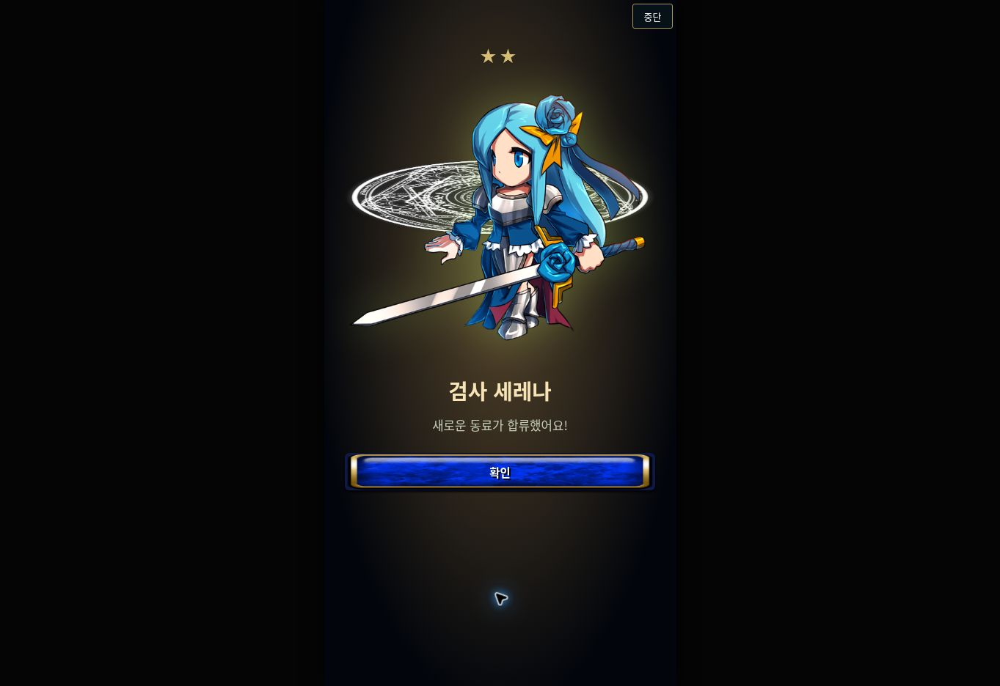
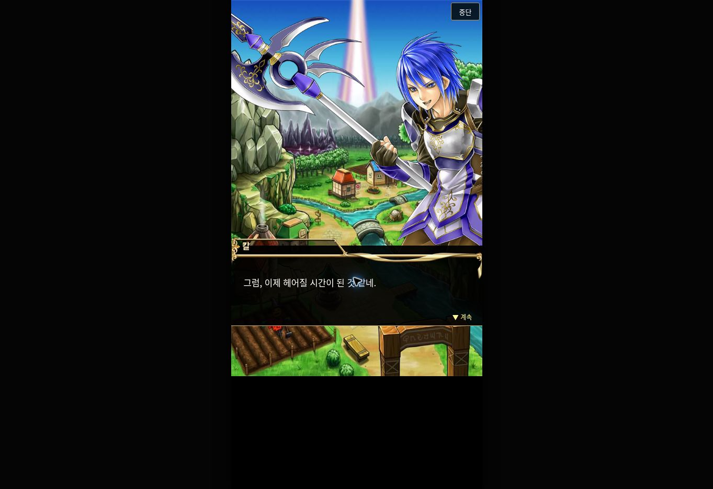

# 기본 튜토리얼 연결 복원 — 0.4.0

2026-10-25. 첫 작업 범위는 기존 두 훈련을 기본 새 게임 경로로 연결하고, 칼의 선물·소환·작별 뒤 홈까지 이어지게 하는 것이다. 원본의 모든 페이지·프레임을 완료했다는 뜻은 아니다.

## 기준과 확인 근거

| 구분 | 기준 자료 | 확인 범위 |
| --- | --- | --- |
| 기본 분기 | 제공된 GL APK 2.19.6.0, ARM64 `libgame.so` | chapter1 → 9 → 10 → 11 → 12/홈 |
| 스크립트 이름 | `GameUtils::getTutorialScriptFile @0x1eb8758` | 1=tuto1, 9=tuto9, 10=tuto15, 11=tuto16 |
| 첫 전투의 다음 단계 | `TutorialStepScene::updateEvent @0x1b9388c–0x1b93894` | chapter9 직접 기록, 2~8을 기본 경로에서 생략 |
| 대사·행동 | 2022 GL 보존 `tuto15`·`tuto16` | 원문 줄 번호를 실행 데이터에 보관하고 한국어로 번역 |
| 전투 수치 | 기존 2014 GL mission1/2 보존 캡처 | 이전 구현 유지, 대상 APK와 전체 수치 일치 미확인 |
| 선물·소환 | tuto15:78 / :114 | 선물 표시 5개, 소환 비용 5개. 서버 지급 시점은 불명 |

[기계 판독 근거](sources/tutorial-native-proof.json)와 [ARM64 명령·분기표](sources/tutorial-native-proof.txt)에 실행 주소·복구 조건을 남겼다. 바이너리 SHA-256은 `076c8ed12e84d122938255c1530a4d4b1853d876b5928dd0c2389538fc4cad95`, 제공 APK는 `346d29478b3a2a8246c79267abf7c5d9e1e785b10d63677dbdf93fb14d139bf9`다.

## 연결과 저장 동작

1. 첫 영웅 선택 후 전투 기초 3웨이브를 진행한다.
2. 완료 화면의 안내 계속으로 속성·필살기 3웨이브에 들어간다.
3. 티리스의 초원 작별 대사 뒤 칼의 귀환·원정 대사로 전환한다.
4. 5보석 선물을 한 번 지급하고 소환 메뉴 → 소환 버튼 → 확인으로 안내한다.
5. 소환 확정 시 재화 차감, 획득 유닛, 결과, 다음 단계가 같은 저장 레코드에 반영된다.
6. 게이트·결과를 거쳐 칼의 작별 대사를 마치면 바로 홈으로 돌아간다.

선물 지급과 진행 단계 역시 함께 저장한다. 이미 넘긴 버튼의 재입력은 거부한다. 게이트에서 새로고침하면 같은 획득 결과로 연출을 다시 열며 재추첨·추가 차감하지 않는다. 지급 후 잔액이 부족하고 저장된 소환 결과가 없다면 원본 chapter10의 복구 분기처럼 작별로 이어진다. 저장된 소환 결과가 있으면 잔액과 무관하게 결과부터 재개한다.

기존 0.3.0 저장에는 새 안내를 강제 시작하지 않는다. 홈의 안내에서 **처음부터 안내 다시보기**를 선택하면 별도 임시 진행을 사용한다. 다시보기는 원래 저장에 보상·유닛·진행을 합치지 않고, 중단·종료 시 원래 모험을 돌려준다. 일반 새 게임에서는 중단 후 **첫 모험 안내 이어서** 또는 타이틀의 **모험 이어하기**로 재개한다.

`PARAM40`은 표시 전환이며 +5보석 명령이 아니다. 이 구현의 선물 지급은 대사 금액을 따른 명시적 웹 재현 모델이다. 원본 서버의 초기 지급·재요청 처리나 계정 간 동기화를 복원한 것으로 표시하지 않는다. 기존 웹 초기 보석 6개, 소환 풀·확률·중복 카르마 규칙은 그대로다.

## 완료 검증

- 자동 검사 41개 통과. 새 검사 6개는 실제 전투를 포함한 네 시작 영웅의 완주, 단계별 저장 왕복, 잘못된 조작과 중복 입력, 잔액 부족 복구, 기존 저장 호환, 손상된 단계 거부를 확인한다.
- 원본 자산 236개(APK 220, 보존 16)의 해시·로컬 참조와 모션 범위 통과. 칼의 이미지·마을 배경 등 9개를 원본 APK에서 추가했다.
- 브라우저에서 새 게임·이름 입력·발가스 선택·6개 전투·칼의 소환·작별·홈까지 직접 조작했다. 필살기 안내의 길게 누르기는 대응 키보드 Space, 발동은 표시된 필살기 버튼으로 검사했다.
- 선물 직후 새로고침: 보석 11 유지. 소환 지불 직후 새로고침: 게이트 복구. 결과 화면 새로고침: 세레나 결과 유지. 종료 후 새로고침: 홈, 보석 6, 동료 4 유지. 시작 값은 보석 6, 동료 3이었다.
- 안내 중 다른 메뉴 클릭이 진행을 바꾸지 않음을 확인했다. 기존 저장을 열고 다시보기 시작·중단 후 원래 보석 6, 젤 2,500, 카르마 800, 동료 3이 유지됨을 확인했다.
- 새 대사 화면에서 깨진 이미지·가로 넘침 없음. 480px 게임 컨테이너의 브라우저 검증이며 실제 휴대폰 기기의 모든 비율·터치·음향 검증은 아니다.

## 별도로 남긴 항목

- chapter2~8은 잔존 분기, chapter50~53은 완료 뒤 메뉴에서 시작 가능한 별도 안내다. 전자를 기본 새 게임 중간에 삽입하지 않으며 후자의 기능·시점은 T09에서 계속 다룬다.
- chapter54는 홈으로 종료한다. 기본 경로에 세 번째 필수 전투를 만들 근거가 없다. tuto101~103은 에피소드3·소환사 화면 안내다.
- 도입 입자, 첫 영웅 화면, 임시 전투 아군·피해·보상, 전체 프레임·대기 시간·정식 한국어 번역 일치는 T01/T02/T06/T07/T08에 남긴다.
- 이 변경은 CSV/SAM 전체 시나리오 엔진을 구현한 것이 아니다. 전체 화면 이동·효과·소환 데이터는 B04/G01 등 별도 항목이다.

원본 차이 체크리스트에서 T03(연결), T04(기본 경로 검증), T05(소환·작별 연결)만 완료 표시했다. 첫 작업 결과를 보고한 뒤 기존 Vercel 프로젝트의 main 배포로 반영한다.
