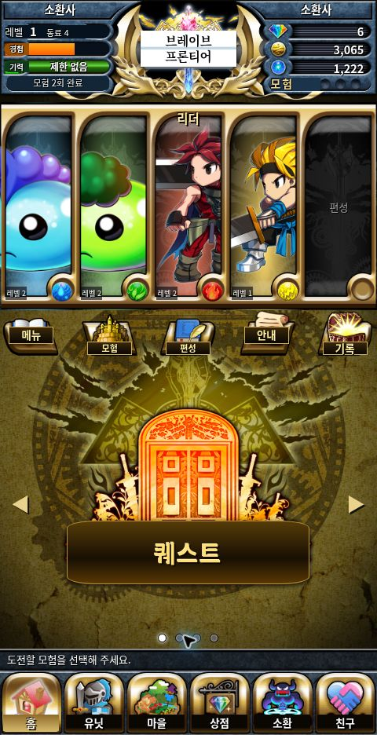
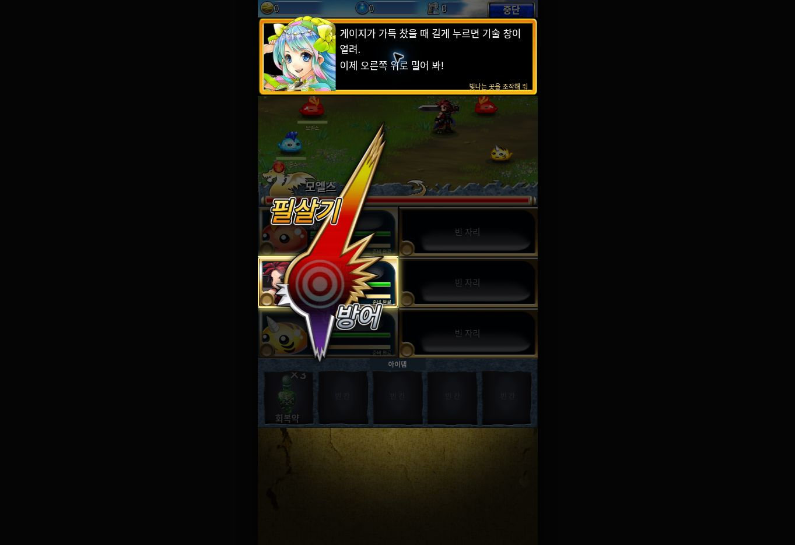
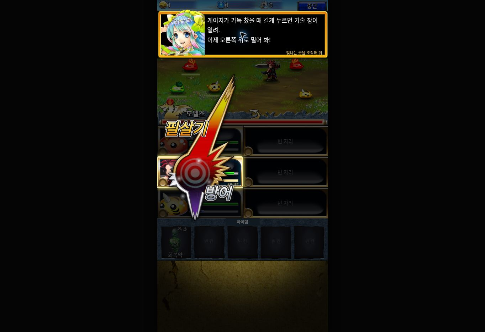

# 검증 기록

검증일: 2026-10-24. 정적 웹판 0.2.0. 원작 전체가 동일하다는 검증이 아니라 아래 구현 범위의 동작·원문 대조·화면 확인입니다.

## 자동 검증

`npm test`: 33개 통과.

- 24종 모두 한국어 원문 일반 타격 프레임·피해 분배와 실제 타격 수 대조.
- SAM 11종의 24fps·구간·이미지 연결, 객체·행렬·RGBA 보간과 기본 변환.
- HP를 입력 직후 차감하지 않고 실제 타격 시점에 차감, 같은 타깃·프레임의 양쪽 스파크, 서로 다른 프레임·타깃 제외, 동일 공격자의 같은 프레임 처리.
- 사망 뒤 추가 타격의 실제 피해 0, 예약 모션 종료 전 차례·보상 이동 방지.
- 게이지 즉시 소비, 방어·피격 고정 게이지 보너스 제거, 적 공격 타격 예약과 차례 종료.
- 결정 상한, 하트 부상자 우선, 비행 중 수치 유지·도착 시 한 번만 반영.
- 시작 영웅 4명 × 난수60개 = 첫 일반 모험 240회 완주. 최대 성장한 5명으로 웹판 8개 모험 완주.
- 중복 행동·회복약 횟수·전멸·패배·보상 중복 지급·해금·성장 비용·편성 제한·소환·저장 구조 검증.
- 시작 영웅 4명 모두 훈련 두 장의 전투6회 완료. 각 전투 시작 지점 재개, 필수 조작 건너뛰기 방지, 보스 선공 후 지정 대상 회복, 이전 저장 기록 유지.

`npm run check`: JS 구문, 원본 자산207개의 크기와 SHA-256, 24종 이미지·자르기 범위·모션·아틀라스 회전, 로컬 참조와 문서 언어 확인. 실행 파일에서 외부 URL을 참조하지 않는지도 확인합니다.

## 브라우저 실제 조작

1. 원본 영어 로고가 타이틀·헤더에서 그대로 보임.
2. 첫 장의 현재 전투부터 재개, 뒤 적 지정, 지정 공격 순서, 하트·상자, 보스 선공·지정 회복, 마지막 전투 완료.
3. 두 번째 장 속성 훈련, 물 적에 번개 공격, 결정·게이지 안내, 길게 누르기, 오른쪽 위 드래그로 BB 발동, 보스와 완료 화면까지 진행. 완료 후 다시 보기도 확인.
4. 원본 SAM 메뉴의 BB/Guard 분기, 한글 글자 위치, Add.sam 가산 연출 확인. BB 없는 일반 전투에서 가드만 표시, 아래로 드래그하면 방어가 반영됨. 키보드 스페이스·Esc 조작도 확인.
5. 24종 전부 상세 열기→공격 모션→이전 목록 복귀. 480px 컨테이너에서 가로 넘침 없음. 결과는 `unit-ui-audit.json`.
6. 5번째 동료 란셀 추가→5명 편성 저장→홈 복귀. 편성 테두리 중복을 발견해 수정 후 재확인.
7. 일반 전투에서 방어→자동·2배속→3연전 완료. 결정 도착을 기다린 뒤 다음 차례·결과로 정상 진행.
8. 영웅 소환에서 보석5개를 한 번 차감, 원본 게이트 닫힘→열림·가산 빛→란셀 결과. 소환 버튼의 남아 있던 영문을 가리고 재확인.
9. 홈·마을·상점·소환·친구 페이지의 가로 넘침과 깨진 이미지 없음. 설정과 훈련 연결 확인. 결과는 `page-ui-audit.json`.
10. 마지막 전투·훈련 후 홈 수치: 동료5, 완료4회, 젤3,765, 카르마1,582, 보석1. 훈련 재시도와 취소한 일반 전투는 이 값들을 바꾸지 않음. 앱 출처의 브라우저 콘솔 오류 없음.

검증 브라우저의 진행 상황이며 소스·배포 파일에 저장 데이터를 넣지 않았습니다. 새로고침 시 저장된 동료와 편성도 유지됩니다. 이전 확인에서 저장 파일 다운로드의 JSON과 화면 수치가 일치하는 것을 확인했습니다.

메뉴 좌표 보정 도중 튜토리얼 손 안내에 잘못 적용된 변수가 실제 화면 확인에서 발견되었습니다. 범위를 수정하고 같은 훈련을 다시 처음부터 완료했습니다. 명령 SAM 두 종류를 겹쳐 그리던 문제도 native 분기와 비교해 수정했습니다.

## 검증 한계

실제 안드로이드·아이폰 기기 터치·음향, 원작 실행 화면과의 동시 녹화·픽셀 차이, 모든 원작 페이지·온라인 서버 결과는 검증하지 못했습니다. 원본 미확보 영역은 [캐릭터·페이지 검토표](캐릭터-페이지-검토.md)에 따로 적었습니다. 정확한 전체 재현으로 표시하지 않습니다.

파일 불러오기 UI는 이전에 브라우저 파일 업로드 승인이 거절되어 실제 파일 선택부터 완료까지 검증하지 못했습니다. 저장 JSON 검사·복원 로직은 자동 검증을 통과했습니다.

## 2026-10-25 보존 자료 적용

자동 검증 35개 통과. 기존 33개에 여섯 웨이브 원문 캡처 수치 일치와 물 속성 타깃 선택 검증을 추가했습니다. SAM 14개·24캐릭터·227배포 자산의 해시와 모션 범위를 검사했습니다. 공개 아카이브 3,738개 파일은 개별 CRC32·SHA-256으로 검증했고 마스터 9개도 원문 해시를 보존했습니다. 다운로드 스크립트의 기존 파일 재사용 경로를 확인했습니다. 브라우저에서 새로 시작→도입→영웅 선택→훈련 시작→훈련 목록→홈을 확인했고, 미즐스·모릴스와 발가스의 원본 crop을 확인했습니다.

## 0.4.0 기본 튜토리얼 연결 검증

자동 검사 41개와 236개 원본 자산의 해시·모션·참조 검사 통과. 새 게임의 여섯 전투부터 칼의 선물, 소환 안내, 게이트, 결과, 작별, 홈까지 브라우저 조작으로 완주했습니다. 보석은 6→11→6, 동료는 3→4로 반영됐습니다. 선물 지급 직후, 소환 지불 직후, 소환 결과 화면, 완료 후 네 번 새로고침하여 중복 지급·지불 없이 복원됨을 확인했습니다. 기존 저장도 열리고 다시보기 중단 후 원래 기록이 유지됩니다. 상세 근거와 한계는 [연결 복원 기록](tutorial-journey-restoration.md)에 있습니다.

## 0.5.0 도입·전투 시점 복원 검증

2026-10-25. `npm test` 56개와 `npm run check` 통과. 배포 자산244개(APK228+보존16), SAM16개의 해시·참조·구문을 확인했습니다. [구현 범위와 주소별 근거](tutorial-detail-restoration.md)를 별도로 기록했습니다.

새 검증용 저장 `도입전투검증`으로 브라우저에서 도입부터 기본 경로를 완주했습니다.

- 기존 0.4 저장 로드, 새 게임 도입의 한글 문자 출력·입자·이름 입력, 좌우 영웅 선택, 건너뛰기 확인의 아니요→시작 복귀를 확인했습니다. 원본 실행 영상과 픽셀 비교한 결과는 아닙니다.
- 첫 훈련에서 지정 공격 사이 안내 정지, 뒤 적 선택, 실제 적 공격 후 HP 감소, 결정 도착 후 회복, 상자, 보스 선공과 회복약, 자유 전투를 확인했습니다.
- 두 번째 훈련에서 물 적에 번개 동료 공격, 속성 안내, 결정 수거를 확인했습니다. 필살기 안내 시 화면 게이지는 불 지원10%·리더100%·번개 지원30%로, 지원 유닛까지 강제로 최대치가 되지 않았습니다.
- 키보드 스페이스의 길게 누르기 대체 조작→원본 SAM 필살기 메뉴→필살기 버튼, 여섯 전투 완료, 칼의 선물·소환·결과·작별→홈을 확인했습니다. 실제 모바일 터치 기기는 미검증입니다.
- 선물 전 보석6→선물 후11→소환 후6→완료 보상 후9, 젤2,500→102,500, 동료3→4를 확인했습니다. 완료 후 새로고침→이어하기에서도 동일 수치가 유지돼 중복 지급되지 않았으며 앱 출처 콘솔 오류가 없었습니다. 전투 훈련에는 임의의 전투 경험치·젤을 추가하지 않았습니다.

